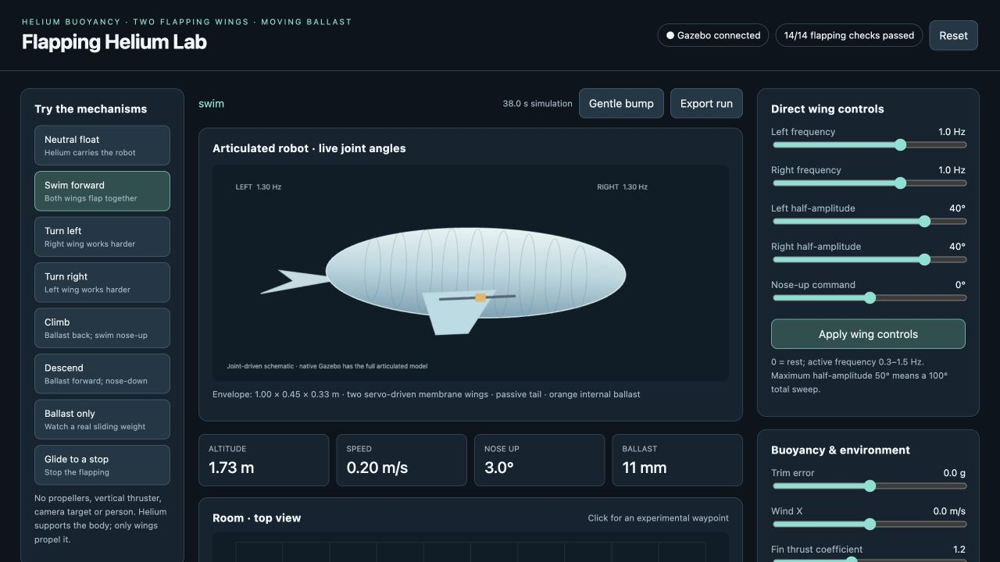

# Flapping Helium Lab

A Gazebo simulation of a helium-supported robot with two articulated flapping
wings, a passive tail and sliding internal ballast. Includes a browser control
panel, native C++ physics plugin, model generator and automated tests.

Inspired by [Cuddle-Fish](https://kaikunze.de/papers/pdf/xu2025cuddle.pdf).
This is an independent experimental simulation; aerodynamic coefficients are
estimated and have not been validated against hardware.



## Get started

The current setup targets macOS with Homebrew Gazebo Jetty, Python 3.14, CMake
and a C++ compiler already installed.

```sh
cd floating-companion
./scripts/setup.sh
./start.command --gui
```

Open http://127.0.0.1:8765 for the controls. Omit `--gui` to run the Gazebo
physics server with only the browser dashboard.

See the [project documentation](floating-companion/README.md) for controls,
physics assumptions, limitations and testing instructions. Saved results include
14 passing Gazebo integration checks and 7 passing unit tests.
